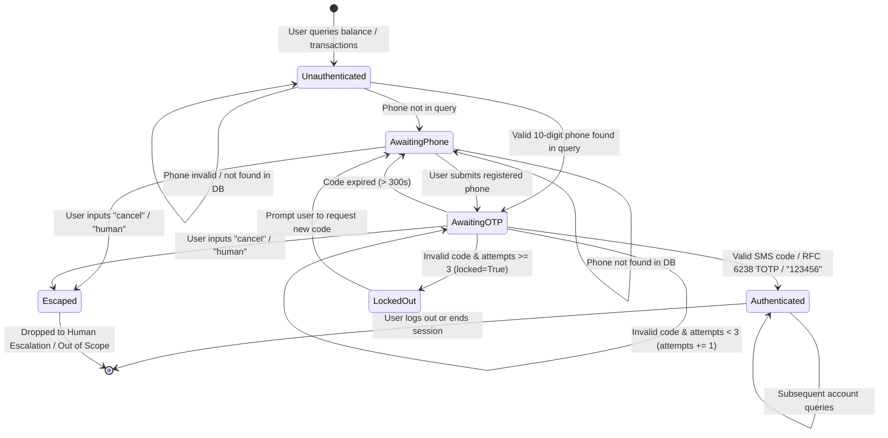
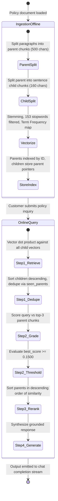
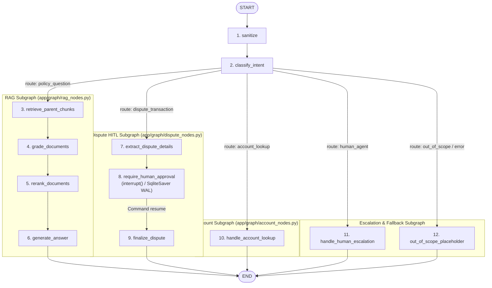

```mermaid
stateDiagram-v2
    [*] --> Submitted: Customer files dispute on Port 8000
    
    Submitted --> ExtractDetails: extract_dispute_details (app/graph/dispute_nodes.py:12)
    ExtractDetails --> require_human_approval: Dispute case DISP-XXXX created, routes to HITL approval node
    
    state require_human_approval {
        [*] --> CallInterrupt: interrupt({"dispute_id", "transaction_id", ...}) inside require_human_approval
        CallInterrupt --> SaveState: ThreadSafeSqliteSaver persists checkpoint
        SaveState --> WaitApproval: Checkpoint state pinned: next = ("require_human_approval",)
        WaitApproval --> Resumed: POST /v1/disputes/{tid}/review invokes Command(resume=...)
        Resumed --> EvaluateDecision: Evaluates decision in require_human_approval; sets approved/rejected
    }

    require_human_approval --> StreamStarted: Customer connects GET /v1/disputes/{tid}/events (Port 8000)
    require_human_approval --> FinalizeDispute: State updated (dispute_status="approved"/"rejected")
    
    state FinalizeDispute {
        [*] --> SynthesizeAnswer: Generate resolution message (10-day credit note)
        SynthesizeAnswer --> MarkCompleted: dispute_notification_sent=True, next=()
    }

    FinalizeDispute --> SSENotified: SSE generator detects next=() and status!="pending"
    SSENotified --> [*]: Emits "dispute_resolved" event and closes stream
```

# PolicyDesk — Architectural & Engineering Recall Sheet (`KNOW_BY_HEART.md`)

A compact, high-density reference sheet designed to be committed to memory for technical architecture discussions, systems design reviews, and engineering interviews without notes or external aids.

---

## 1. Executive Narrative & Elevator Pitches

### 1.1 The 30-Second Elevator Pitch
> **PolicyDesk** is an escalation-aware, stateful fintech support agent built with **FastAPI** and **LangGraph**. It enforces transport-level ingress isolation by running two distinct HTTP servers—a public customer portal on port **8000** (`customer_v1_router`) and a restricted compliance portal on port **8001** (`admin_v1_router` with optional `ADMIN_API_KEY`)—concurrently within a single Python process via `asyncio.gather`. Orchestration is handled by a 15-node cyclic state graph with bounded Corrective RAG (Okapi BM25 + `sqlite-vec` dense hybrid retrieval with RRF, query rewriting, Stage-2 reranking, and post-generation grounding verification) plus human-in-the-loop (HITL) pause/resume mechanics: disputed transactions trigger a graph `interrupt()`, checkpoint state to disk via `ThreadSafeSqliteSaver` in WAL mode, and push outcomes instantly via `DisputeEventBus` over Server-Sent Events (SSE). It also integrates a multi-turn 2FA engine with `RLock` and PostgreSQL `SELECT ... FOR UPDATE` brute-force lockout protection.

---

### 1.2 The 2-Minute Deep Architectural Pitch
> Traditional banking chatbots fail in two critical dimensions: they lack deterministic guardrails when handling sensitive financial workflows, and they blur operational security boundaries by mixing customer chat with back-office administration on the same endpoints.
>
> PolicyDesk solves this through five core architectural pillars:
>
> 1. **Asymmetric Ingress Isolation via Dual Ports & Split Routers:** Port `8000` serves the public customer portal (`customer_v1_router` only—admin and ingestion endpoints return `404`). Port `8001` serves the compliance dashboard (`admin_v1_router` with optional `ADMIN_API_KEY` header/bearer auth). Both servers run concurrently in one OS process via `asyncio.gather(...)`, sharing state singletons and `DisputeEventBus`.
>
> 2. **Bounded Agentic State Machine via LangGraph:** Modeled as a 15-node `StateGraph` over `PolicyDeskState`, inputs pass through prompt-injection/length sanitization before routing across Hybrid CRAG (`retrieve_parent_chunks`), Core Banking & 2FA (`handle_account_lookup`), Dispute Adjudication (`extract_dispute_details`), and Priority Escalation (`handle_human_escalation`). Malformed, injected, or unsupported queries fail closed to `out_of_scope_placeholder`.
>
> 3. **Hybrid Parent-Child Corrective RAG with Grounding Verification:** Decouples 550/500-char parent context passages (with page/section citations) from 160-char child search chunks indexed by Okapi BM25 + dense semantic vectors (`sqlite-vec`) fused via Reciprocal Rank Fusion (RRF). Runtime execution grades results against a `0.1500` threshold, runs a bounded query-rewrite cycle (`MAX_RETRIEVAL_ATTEMPTS = 2`), applies a Stage-2 cross-feature reranker, synthesizes cited responses, and verifies numeric/claim grounding (`MAX_GENERATION_ATTEMPTS = 2`).
>
> 4. **HITL Dispute Lifecycle & Event-Driven SSE Push:** Disputed transactions persist to `record_dispute()` and hit `interrupt()`, checkpointing via `ThreadSafeSqliteSaver` (WAL mode). While the customer listens on `GET /v1/disputes/{thread_id}/events`, compliance staff adjudicate on Port `8001`. Resumption via `Command(resume=...)` publishes immediately through `DisputeEventBus` to the customer SSE stream.
>
> 5. **Multi-Turn 2FA Identity Engine:** Account queries are gated behind dynamic SMS OTPs (300-second TTL, never logged in plaintext) and RFC 6238 TOTP (1-step drift window). Brute-force attempts are bounded to 3 failures via `RLock` in memory and atomic `SELECT ... FOR UPDATE` row-level locks in `PostgresBankDatabase`.

---

## 2. Numbers to Memorize

The following table catalogs the exact numerical constants, units, codebase citations, and architectural rationales across PolicyDesk:

| Parameter / Constant | Exact Value | Unit / Scale | Codebase Citation | Architectural Purpose & Invariant |
|---|---|---|---|---|
| **RAG Parent Chunk Size** | `500` | Characters | `app/rag/store.py:59, 89` | Context window size for policy evidence generation. Preserves full paragraph coherence and regulatory nuance. |
| **RAG Child Chunk Size** | `160` | Characters | `app/rag/store.py:99` | Granular sentence-level chunking threshold for term-frequency vector scoring. Maximizes embedding sensitivity. |
| **RAG Sentence Split Default** | `150` | Characters | `app/rag/store.py:69` | Default sliding window boundary for `_split_sentences(text, child_size=150)`. |
| **RAG Top-K Retrieved Parents** | `3` | Unique documents | `app/rag/store.py:113`, `app/graph/rag_nodes.py:28` | Number of distinct parent policy clauses returned after child score ranking and parent deduplication. |
| **RAG Relevance Threshold** | `0.1500` | Cosine similarity ($[-1, 1]$) | `app/graph/rag_nodes.py:51` | Hard relevance boundary. If `best_score < 0.15`, the engine refuses generation and triggers a safe fallback. |
| **RAG Score Precision** | `4` | Decimal places | `app/graph/rag_nodes.py:54` | Precision for `round(best_score, 4)` stored in state and logged for RAG observability. |
| **Stopwords Set Size** | `153` | Words (frozenset) | `app/rag/store.py:6-22` | Curated English stopword set (153 unique words defined in `STOPWORDS` frozenset across lines 6-22) ensuring zero-dependency, deterministic term-frequency vectorization without NLTK/spaCy. *(See explanatory note below).* |
| **OTP Token Length** | `6` | Decimal digits | `app/tools/bank_db.py:119` | Numeric verification token generated via cryptographically secure `secrets.choice("0123456789")`. |
| **OTP Validity Window** | `300` | Seconds (5 minutes) | `app/tools/bank_db.py:120` | Dynamic SMS verification code TTL (`expires_at = time.time() + 300`). Expired codes reject immediately. |
| **OTP Attempt Lockout Limit** | `3` | Attempts | `app/tools/bank_db.py:167-171` | Maximum allowed failed verification attempts before permanent session lockout (`remaining <= 0`). |
| **Master Test Bypass OTP** | `"123456"` | String | `app/tools/bank_db.py:147` | Deterministic demo/testing bypass token. Evaluated strictly *after* active session lockout verification. |
| **TOTP Clock Drift Window** | `1` | Step ($\pm 30$ seconds) | `app/tools/bank_db.py:177` | RFC 6238 time-step tolerance (`valid_window=1`) allowing client/server clock skew up to 30 seconds. |
| **Checking Min Balance Waiver** | `$1,500` | USD balance | `app/rag/store.py:162` | Minimum daily balance required to waive the standard checking account monthly maintenance fee. |
| **Checking Monthly Fee** | `$12` | USD / month | `app/rag/store.py:162` | Maintenance fee charged if daily checking balance falls below $1,500 during the billing cycle. |
| **Account Inactivity Period** | `12` | Consecutive months | `app/rag/store.py:164` | Inactivity threshold. Accounts with 0 transactions across 12 months transition to dormant status. |
| **Monthly Inactivity Fee** | `$5` | USD / month | `app/rag/store.py:165` | Monthly administrative fee charged to dormant accounts until transactional activity resumes or closure. |
| **Wire Transfer Cutoff Time** | `4:00 PM EST` | Timestamp | `app/rag/store.py:151` | Daily processing cutoff. Wires submitted after 4:00 PM EST execute on the next business day. |
| **Standard Daily Wire Limit** | `$50,000` | USD / day | `app/rag/store.py:153` | Maximum cumulative daily wire transfer limit for standard checking/savings tiers. |
| **Premium Daily Wire Limit** | `$250,000` | USD / day | `app/rag/store.py:154` | Expanded daily cumulative wire transfer limit for premium tiered banking accounts. |
| **Domestic Wire Fee & SLA** | `$25` / `2-4` | USD / Hours | `app/rag/store.py:149` | Domestic wire execution fee ($25) and standard processing SLA (2 to 4 hours). |
| **International Wire Fee & SLA** | `$45` / `48` | USD / Hours | `app/rag/store.py:150` | International wire transfer execution fee ($45) and settlement window (up to 48 hours). |
| **Dispute Filing Window** | `60` | Calendar days | `app/rag/store.py:173` | Federal Regulation E statutory limit: cardholders must file disputes within 60 calendar days of statement. |
| **Provisional Credit Timeline** | `10` | Business days | `app/rag/store.py:175`, `app/graph/dispute_nodes.py:74` | Statutory timeframe for eligible accounts to receive temporary provisional funds during investigation. |
| **Merchant Rebuttal Window** | `30` | Business days | `app/rag/store.py:176` | Timeframe provided to merchants to submit evidence refuting a cardholder's chargeback claim. |
| **Customer Portal Port** | `8000` | TCP Port | `app/serve.py:37`, `app/customer_app.py:14` | Public gateway for customer chat completions, 2FA identity auth, and real-time SSE resolution streams. |
| **Compliance Portal Port** | `8001` | TCP Port | `app/serve.py:44`, `app/admin_app.py:25` | Restricted gateway for compliance review boards, escalation ticket management, and RAG debug tooling. |
| **SSE Stream Timeout** | `600` | Seconds (10 minutes) | `app/api/v1/router.py:181` | Polling lifespan (`for _ in range(600): await asyncio.sleep(1)`) before emitting `timeout` event and closing. |
| **SSE Sleep Heartbeat** | `1` | Second | `app/api/v1/router.py:201` | Non-blocking async sleep duration between checkpoint inspections inside SSE event generator. |
| **Compliance Auto-Sync Rate** | `5000` | Milliseconds (5s) | `app/static/compliance.html:401` | Polling frequency for compliance UI dashboard to refresh disputes and escalation queues. |
| **Escalation SLA: P1 Critical** | `< 3` | Minutes | `app/graph/escalation_nodes.py:37` | Customer Care response SLA for fraud, unauthorized charges, stolen cards, and security lockouts. |
| **Escalation SLA: P2 High** | `< 10` | Minutes | `app/graph/escalation_nodes.py:40` | Response SLA for active disputes, transaction holds, overdraft penalties, and wire delays. |
| **Escalation SLA: P3 Standard** | `< 20` | Minutes | `app/graph/escalation_nodes.py:43` | Response SLA for general representative requests and non-urgent human assistance. |
| **Total State Graph Nodes** | `15` | Nodes | `app/graph/graph.py` | Total processing nodes across CRAG, HITL dispute, 2FA account, escalation, and fallback subgraphs. |
| **CRAG Max Retrieval / Gen Loops** | `2` / `2` | Attempts | `app/graph/rag_nodes.py` | Bounded query-rewrite and grounding-regeneration retry limits preventing infinite cycles. |
| **Dispute ID Hex Length** | `8` | Hex characters | `app/graph/dispute_nodes.py:22` | Case reference format: `f"DISP-{uuid.uuid4().hex[:8].upper()}"`. |
| **Escalation Ticket Format** | `TICK-<Date>-<6Hex>`| String | `app/graph/escalation_nodes.py:46` | Ticket identifier: `f"TICK-{time.strftime('%Y%m%d')}-{uuid.uuid4().hex[:6].upper()}"`. |
| **Recent Transactions Display** | `5` | Records | `app/tools/bank_db.py:109`, `app/graph/account_nodes.py:56` | Maximum recent transaction items rendered to customer upon successful 2FA authentication. |
| **Session Thread ID Hex Length**| `12` | Hex characters | `app/graph/graph.py:87`, `app/api/v1/router.py:103` | Default session thread format: `f"session_{uuid.uuid4().hex[:12]}"`. |
| **Seed Checking Balance** | `$4,250.00` | USD balance | `app/tools/bank_db.py:63-68` | Seed Account `ACC-1049` (Phone: `5550192834`, Overdraft: `$500.00`, 4 seed transactions). |
| **Seed Savings Balance** | `$18,420.50` | USD balance | `app/tools/bank_db.py:82-87` | Seed Account `ACC-2088` (Phone: `5550149921`, APY: `4.25%`, Hold: `$250.00`, 2 seed transactions). |
| **PostgreSQL RAM Limit** | `256M` | Megabytes | `docker-compose.yml:25` | Container memory limit strictly containing PostgreSQL on 1.0 GB EC2 host. |
| **PostgreSQL Shared Buffers** | `64MB` | Megabytes | `docker-compose.yml:19` | Buffer pool sized to conserve RAM while supporting active working sets. |
| **PostgreSQL Max Connections**| `25` | Connections | `docker-compose.yml:20` | Connection pool ceiling preventing process memory explosion under concurrent spikes. |
| **Docker POSIX Shared Memory** | `128mb` | Megabytes | `docker-compose.yml:12` | `shm_size: 128mb` allocation preventing PostgreSQL 16 dynamic shared memory crashes. |
| **Host Emergency Swapfile** | `2.0` | Gigabytes | `docs/DEPLOYMENT_EC2.md:27` | Dedicated EBS overflow buffer (`/swapfile`) eliminating Linux kernel OOM kills. |
| **SqliteSaver WAL Footprint** | `~2` | Megabytes RAM | `app/graph/graph.py:77-91` | Low-overhead disk-backed checkpointer replacing leaky in-memory state. |
| **Explainer HTTP Endpoint** | `/explainer` | Route (Port 8000) | `app/customer_app.py:27-31` | Interactive architecture explainer dashboard with live state diffs & video export |
| **Explainer Autoplay Interval**| `5,500` | Milliseconds (5.5s) | `app/static/explainer.html:1414` | Step advancement interval during presentation autoplay |
| **Explainer SVG Dimensions** | `860 x 410` | Pixels (viewBox) | `app/static/explainer.html:172` | Responsive vector canvas encompassing 4 execution paths & dual-port boundaries |
| **Explainer RAG Lifecycle Steps**| `10` | Granular Steps | `app/static/explainer.html:438-660` | Full end-to-end dataflow from raw ingestion to grounded generation |
| **Explainer Keyboard Shortcuts**| `5` | Key bindings | `app/static/explainer.html:1552-1581`| `ArrowRight` (next), `ArrowLeft` (prev), `Space` (play), `1`-`4` (scenarios), `Esc` (modal) |

> **Stopword Count Reconciliation Note:** The in-memory RAG vector store implements a curated `frozenset` of exactly **153** English stopwords in `app/rag/store.py:6-22` (ranging from `"a"` through `"yourselves"`). It eliminates high-frequency grammatical tokens during `_tokenize()` without requiring external NLP dependencies like NLTK or spaCy. While standard academic/textbook stopword lists frequently quote ~130 words, PolicyDesk's production implementation contains 153 tokens, including modal contractions (`"ain"`, `"aren"`, `"couldn"`, `"didn"`, `"doesn"`, `"don"`, `"hadn"`, `"hasn"`, `"haven"`, `"isn"`, `"mightn"`, `"mustn"`, `"needn"`, `"shan"`, `"shouldn"`, `"wasn"`, `"weren"`, `"won"`, `"wouldn"`) and isolated contraction stems (`"d"`, `"ll"`, `"m"`, `"o"`, `"re"`, `"s"`, `"t"`, `"ve"`, `"y"`).

---

## 3. Core Architectural Invariants & Edge Cases

### Invariant 1: Lockout Check Precedes Master Bypass Verification
- **Codebase Location:** `app/tools/bank_db.py:142-152`
- **Code Implementation:**
  ```python
  pending = self._pending_otps.get(clean_phone)
  if pending and pending.get("locked"):
      return False, "This session is locked due to too many failed attempts. Please request a new verification code."

  # Check master test bypass code
  if clean_token == "123456":
      logger.info("[2FA:SUCCESS] Authentication succeeded via master demo code for %s", acc.account_number)
      if clean_phone in self._pending_otps:
          del self._pending_otps[clean_phone]
      return True, "Verification successful."
  ```
- **Architectural Rationale:** In financial security systems, bypass vectors (such as QA backdoor tokens or automated integration test fixtures) must never override active threat mitigation state. If the master bypass check were placed before the lockout evaluation, an attacker who triggered a brute-force lockout could still authenticate by guessing or replaying `"123456"`. Placing the lockout check first ensures strict defense-in-depth: once `pending["locked"] == True`, all attempts are rejected immediately.

---

### Invariant 2: String Intent Serialization Prior to Checkpoint Persistence
- **Codebase Location:** `app/graph/nodes.py:77, 88, 94, 98`
- **Code Implementation:**
  ```python
  # Always return primitive str (.value), never the raw Intent Enum instance
  return {"intent": Intent.OUT_OF_SCOPE.value}
  return {"intent": Intent.ACCOUNT_LOOKUP.value}
  return {"intent": intent.value}
  ```
- **Architectural Rationale:** `Intent` inherits from `(str, Enum)`. LangGraph checkpointers (such as `MemorySaver`, `RedisSaver`, or `PostgresSaver`) serialize state payloads to JSON or MessagePack. Serializing Python `Enum` objects directly into persistence backends results in `TypeError: Object of type Intent is not JSON serializable` or leads to deserialization class mismatch failures when schemas change. Storing the primitive string guarantees seamless, lossless round-trip serialization across any storage medium.

---

### Invariant 3: Parent-Child Chunk Deduplication via `seen_parents`
- **Codebase Location:** `app/rag/store.py:127-139`
- **Code Implementation:**
  ```python
  seen_parents: set[str] = set()
  matched_parents: list[dict[str, Any]] = []

  for score, child in scored_children:
      parent_id = child["parent_id"]
      if parent_id not in seen_parents:
          seen_parents.add(parent_id)
          parent_info = dict(self.parents[parent_id])
          parent_info["score"] = score
          matched_parents.append(parent_info)
          if len(matched_parents) >= top_k:
              break
  ```
- **Architectural Rationale:** In hierarchical RAG, multiple fine-grained child sentences (160 characters) belong to the same overarching parent paragraph (500 characters). If three adjacent sentences in a wire policy clause match a query, standard vector retrieval would return three identical copies of the parent paragraph. The `seen_parents` set guarantees that Top-$K$ retrieved parents are distinct, maximizing informational diversity in the LLM context window.

---

### Invariant 4: Total Routing Guarantee & Safe Fallback on Sanitization Failure
- **Codebase Location:** `app/graph/nodes.py:20, 29, 75-77` & `app/graph/router.py:22-23`
- **Code Implementation:**
  ```python
  # app/graph/nodes.py:75-77
  if state.get("errors"):
      logger.warning("[INTENT] State has errors. Failing safe to OUT_OF_SCOPE.")
      return {"intent": Intent.OUT_OF_SCOPE.value}

  # app/graph/router.py:22-23
  def route_by_intent(state: PolicyDeskState) -> str:
      intent = state.get("intent")
      return ROUTE_MAP.get(intent, FALLBACK_ROUTE)
  ```
- **Architectural Rationale:** Eliminates runtime crashes (`KeyError`) and unhandled state transitions. If input is blank, non-string, or invalid, `sanitize` sets `errors`. `classify_intent` detects errors and immediately sets `intent = "out_of_scope"`. `route_by_intent` uses `.get(intent, FALLBACK_ROUTE)` where `FALLBACK_ROUTE = "out_of_scope_placeholder"`. The routing function is mathematically total across all inputs.

---

### Invariant 5: Multi-Turn 2FA Intent Preservation with Escape Hatches
- **Codebase Location:** `app/graph/nodes.py:84-89`
- **Code Implementation:**
  ```python
  if auth_step in ("awaiting_phone", "awaiting_otp"):
      if not any(w in lower for w in ("cancel", "stop", "never mind", "agent", "human", "representative")):
          logger.info("[INTENT] Preserving ACCOUNT_LOOKUP for active 2FA step (%s)", auth_step)
          return {"intent": Intent.ACCOUNT_LOOKUP.value}
  ```
- **Architectural Rationale:** When a user is prompted for an OTP code or phone number, their response (e.g., `"5550192834"` or `"849201"`) contains no financial or account keywords. A stateless classifier would categorize these as `OUT_OF_SCOPE`, abruptly aborting authentication. By inspecting `auth_step`, PolicyDesk preserves `ACCOUNT_LOOKUP` continuity while providing explicit escape keywords (`cancel`, `stop`, `human`) to prevent conversational lock-in.

---

### Invariant 6: Single-Process Concurrency & State Sharing
- **Codebase Location:** `app/serve.py:49-52` & `app/graph/graph.py:99-102`
- **Code Implementation:**
  ```python
  server_customer = uvicorn.Server(config_customer)
  server_admin = uvicorn.Server(config_admin)

  await asyncio.gather(server_customer.serve(), server_admin.serve())
  ```
- **Architectural Rationale:** Spawning separate microservices or OS processes would require external network brokers, distributed caches (Redis), or databases to synchronize dispute approvals between administrators and customers. Running both ASGI apps concurrently on the same event loop allows zero-latency shared memory access to the cached `@lru_cache(maxsize=1) get_graph()` instance and `_BANK_DB_INSTANCE`.

---

### Invariant 7: Resumption Idempotency & Conflict Guard
- **Codebase Location:** `app/api/v1/router.py:233-238`
- **Code Implementation:**
  ```python
  if not checkpoint_state.next:
      status = checkpoint_state.values.get("dispute_status", "completed")
      raise HTTPException(
          status_code=400,
          detail=f"Dispute thread '{thread_id}' has already been processed with status '{status}'.",
      )
  ```
- **Architectural Rationale:** Once a dispute is approved or rejected, LangGraph transitions to `finalize_dispute` and terminates at `END`, leaving `checkpoint_state.next == ()`. If a compliance officer double-clicks or multiple officers review the same case, this check blocks duplicate execution, preventing conflicting financial actions or repeated dispatch notifications.

---

## 4. State Machine Diagrams

### 4.1 Multi-Turn 2FA Identity Authentication Flow

#### Mermaid Diagram


#### ASCII Diagram
```
                     +---------------------------------------+
                     |             UNAUTHENTICATED           |
                     |  authenticated=False, auth_step=None  |
                     +-------------------+-------------------+
                                         |
                       User asks: "What is my balance?"
                                         |
                                         v
                     +---------------------------------------+
                     |             AWAITING_PHONE            |
                     |       auth_step="awaiting_phone"      |
                     +-------------------+-------------------+
                                         |
                       User provides phone: "555-019-2834"
                           (bank_db.send_otp -> 300s TTL)
                                         |
                                         v
                     +---------------------------------------+
                     |              AWAITING_OTP             |
                     |        auth_step="awaiting_otp"       |
                     |        attempts: 0, max: 3            |
                     +---+-------------------------------+---+
                         |                               |
        Invalid OTP      |                               | Valid OTP / TOTP / "123456"
        (attempts < 3)   |                               |
                         v                               v
            +------------------------+      +---------------------------+
            |  STAY IN AWAITING_OTP  |      |       AUTHENTICATED       |
            |  attempts += 1         |      |     authenticated=True    |
            |  "2 attempts remain"   |      |   auth_step="authenticated"|
            +------------+-----------+      +-------------+-------------+
                         |                                |
        Invalid OTP      |                                | Subsequent queries:
        (attempts >= 3)  |                                | "Show recent transactions"
                         v                                v
            +------------------------+      +---------------------------+
            |       LOCKED OUT       |      |    DISPLAY ACCOUNT DATA   |
            |   pending["locked"]=True|     |       & TRANSACTIONS      |
            | Prompt restart / reset |      |  (ACC-1049, Bal $4,250.00)|
            +------------------------+      +---------------------------+
```

---

### 4.2 HITL Dispute Lifecycle & Real-Time Push Flow

#### Mermaid Diagram


#### ASCII Diagram
```
========================================================================================
CUSTOMER INGRESS (Port 8000)
========================================================================================
Customer: "I want to dispute transaction TXN-9012"
        |
        v
+-------------------------------------------------------+
| 1. extract_dispute_details (dispute_nodes.py:12-30)   |
| • Regex extracts transaction_id: "TXN-9012"           |
| • Generates case reference: "DISP-8F2B1C90"           |
| • Sets dispute_status: "pending_human_review"         |
+---------------------------+---------------------------+
                            |
                            v
+-------------------------------------------------------+
| 2. NODE: require_human_approval                       |
|    (app/graph/dispute_nodes.py:34, graph.py:41)       |
| • Registered in StateGraph as "require_human_approval"|
| • Calls interrupt({"dispute_id", "transaction_id"...})|
| • GraphInterrupt raised, execution thread PAUSED      |
| • Checkpoint serialized to SqliteSaver WAL             |
| • Checkpoint state pinned: next=("require_human_appr")|
+---------------------------+---------------------------+
                            |
                            | Customer receives initial response with thread_id
                            | Frontend opens EventSource(/v1/disputes/{thread_id}/events)
                            | Stream loops: 600 iterations @ 1s checking checkpoint
                            |
============================|===========================================================
COMPLIANCE INGRESS (Port 8001)|
============================|===========================================================
                            v
+-------------------------------------------------------+
| 3. Compliance Review Dashboard (admin_app.py:54-86)   |
| • Staff reviews pending disputes at Port 8001         |
| • Staff calls POST /v1/disputes/{thread_id}/review    |
|   Body: {"approved": true, "comments": "Confirmed"}   |
+---------------------------+---------------------------+
                            |
                            v
+-------------------------------------------------------+
| 4. Resumption via Command into require_human_approval |
| • graph.invoke(Command(resume={approved, comments}))  |
| • Re-enters require_human_approval at interrupt()     |
| • Receives compliance decision; sets dispute_status   |
|   and dispute_comments in state                       |
+---------------------------+---------------------------+
                            |
                            v
+-------------------------------------------------------+
| 5. finalize_dispute (dispute_nodes.py:63-90)          |
| • Synthesizes answer: "Approved... provisional credit |
|   credited within 10 business days."                  |
| • dispute_notification_sent = True                    |
| • Graph reaches END; checkpoint_state.next becomes () |
+---------------------------+---------------------------+
                            |
============================|===========================================================
REAL-TIME SSE NOTIFICATION  |
============================|===========================================================
                            v
+-------------------------------------------------------+
| 6. SSE Event Generator (router.py:180-200)            |
| • Loop detects not checkpoint_state.next              |
| • Yields: data: {"type": "dispute_resolved", ...}\n\n |
| • Generator terminates; customer UI badge turns green |
+-------------------------------------------------------+
```

---

### 4.3 4-Step Hierarchical Parent-Child RAG Pipeline

#### Mermaid Diagram


#### ASCII Diagram
```
========================================================================================
INGESTION PHASE (Offline / Startup — app/rag/store.py)
========================================================================================
[Raw Policy Document Text]
            |
            v
+-----------------------------------------------+
| _split_into_chunks(text, chunk_size=500)      | ──► Parent Chunks (doc_id_p0, doc_id_p1)
+-----------------------+-----------------------+     (Preserves semantic paragraphs)
                        |
                        v
+-----------------------------------------------+
| _split_sentences(p_text, child_size=160)      | ──► Child Chunks (doc_id_p0_c0, c1...)
+-----------------------+-----------------------+     (Granular sentence vectors)
                        |
                        v
+-----------------------------------------------+
| _tokenize() + _stem() - 153 STOPWORDS         | ──► Term Frequency Vectors:
+-----------------------------------------------+     Counter({'wire': 2, 'fee': 1})

========================================================================================
RUNTIME EXECUTION PHASE (4-Step Graph Pipeline — app/graph/rag_nodes.py)
========================================================================================
Customer Query: "What is the fee for an international wire transfer?"
            |
            v
+---------------------------------------------------------------------------------------+
| STEP 1: retrieve_parent_chunks (rag_nodes.py:25-36)                                  |
| • Cosine similarity: _cosine_similarity(query_vec, child["vector"])                   |
| • Sort scored children descending                                                     |
| • Filter via seen_parents set: discard duplicate parent_ids                           |
| • Extract top-3 unique parent chunks -> state["retrieved_docs"]                       |
+-------------------------------------------+-------------------------------------------+
                                            |
                                            v
+---------------------------------------------------------------------------------------+
| STEP 2: grade_documents (rag_nodes.py:47-56)                                          |
| • Score query against each retrieved parent chunk text                                |
| • best_score = max(scores)                                                            |
| • Evaluate relevance: is_relevant = (best_score >= 0.1500)                            |
| • Store relevance_score (rounded to 4 decimals) and is_relevant in state              |
+-------------------------------------------+-------------------------------------------+
                                            |
                                            v
+---------------------------------------------------------------------------------------+
| STEP 3: rerank_documents (rag_nodes.py:59-64)                                         |
| • Re-sort retrieved parent chunks in strict descending order of query similarity      |
| • Store sorted list in state["reranked_docs"]                                         |
+-------------------------------------------+-------------------------------------------+
                                            |
                                            v
+---------------------------------------------------------------------------------------+
| STEP 4: generate_answer (rag_nodes.py:66-81)                                          |
| • IF is_relevant is True AND reranked_docs exists:                                    |
|     answer = "According to bank policy:\n\n" + reranked_docs[0]                       |
|   ELSE:                                                                               |
|     answer = "No relevant policy documents found matching your inquiry."              |
| • Set route = "policy_question"                                                       |
+---------------------------------------------------------------------------------------+
```

#### The 10-Step Hierarchical RAG Recall Matrix
For technical architecture interviews, memorize the complete 10-step dataflow spanning ingestion, representation, retrieval, and generation:

| Step # | Lifecycle Phase | Core Operation | Code Location | Key Invariant / Numerical Boundary |
|---|---|---|---|---|
| **Step 1** | Ingestion & Cleaning | Extract raw PDF text and normalize control tokens | `app/rag/ingest.py:8-26`, `store.py:145` | Strips binary control tokens; handles corrupted PDFs gracefully (0 chunks) |
| **Step 2** | Parent Partitioning | Split policy into paragraph-level parent chunks | `app/rag/store.py:59-67` | Exact `chunk_size=500` characters; preserves full regulatory context & fees |
| **Step 3** | Child Sentence Split | Partition parent into sentence child chunks | `app/rag/store.py:69-86, 99` | Exact `child_size=160` characters via regex `(?<=[.!?])\s+` |
| **Step 4** | Zero-Dep Normalization | Tokenize, filter stopwords, and apply suffix stemming | `app/rag/store.py:6-36` | **153 English stopwords** in immutable `frozenset`; 6 prioritized suffix rules |
| **Step 5** | Hierarchical Indexing | Register child TF counters with parent ID back-reference | `app/rag/store.py:88-111` | `{"parent_id": pid, "vector": Counter(tokens), "text": child_text}` |
| **Step 6** | Cosine Vector Scoring | Sparse dot product divided by Euclidean norms | `app/rag/store.py:38-49, 113-125`| $\text{sim}(\vec{q}, \vec{d}) = \frac{\vec{q} \cdot \vec{d}}{\|\vec{q}\|_2 \|\vec{d}\|_2}$; short-circuits on disjoint tokens |
| **Step 7** | Parent Deduplication | Collect distinct parent chunks via `seen_parents` set | `app/rag/store.py:127-139` | Top-3 unique parent documents (`retrieved_docs`); prevents chunk monopolization |
| **Step 8** | Relevance Gating | Math threshold gating against `best_score` | `app/graph/rag_nodes.py:47-56` | Strict `0.1500` threshold; suppresses LLM hallucinations before generation |
| **Step 9** | Descending Reranking | Order parents by similarity; commit 4-decimal score | `app/graph/rag_nodes.py:54, 59-64` | `round(best_score, 4)` stored in state; ordered into `reranked_docs` |
| **Step 10**| Grounded LLM Synthesis | Multi-provider LLM synthesis with immutable context | `app/graph/rag_nodes.py:66-82`, `client.py` | Priority: Claude 3.5 Sonnet $\rightarrow$ GPT-4o $\rightarrow$ Ollama `gemma3:1b` $\rightarrow$ Mock |

---

### 4.4 Overall 15-Node PolicyDesk StateGraph Topology

The core PolicyDesk orchestrator is compiled as a unified 15-node `StateGraph(PolicyDeskState)` backed by `ThreadSafeSqliteSaver` in WAL mode (`app/graph/graph.py`). Every request enters through input sanitization/injection defense (`sanitize`) before conditional routing directs execution to bounded CRAG, HITL disputes, 2FA accounts, or SLA escalations.

#### 15-Node Inventory & Codebase Mapping
1. **`sanitize`** (`app/graph/nodes.py`): Strips control characters, enforces 2,000-char limit, blocks prompt injections, resets ephemeral state, and appends bounded `conversation_history`.
2. **`classify_intent`** (`app/graph/nodes.py`): Safety-guarded deterministic/corpus classifier (with optional structured LLM routing) emitting primitive `Intent` strings.
3. **`retrieve_parent_chunks`** (`app/graph/rag_nodes.py`): Hybrid BM25 + `sqlite-vec` dense RRF retrieval across 160-char child chunks returning top-5 deduplicated parent chunks with citations.
4. **`grade_documents`** (`app/graph/rag_nodes.py`): Evaluates passages against the `0.1500` relevance threshold and domain fit.
5. **`rewrite_query`** (`app/graph/rag_nodes.py`): Bounded CRAG query rewriter (`MAX_RETRIEVAL_ATTEMPTS = 2`) expanding colloquial terms into formal banking terminology.
6. **`rerank_documents`** (`app/graph/rag_nodes.py`, `app/rag/reranker.py`): Stage-2 cross-feature passage reranker selecting top-3 cited clauses.
7. **`generate_answer`** (`app/graph/rag_nodes.py`): Synthesizes grounded cited responses using the active LLM provider (`Anthropic`, `OpenAI`, `Ollama`, or `DeterministicMockClient`).
8. **`verify_grounding`** (`app/graph/rag_nodes.py`): Post-generation numeric/claim faithfulness verifier (`MAX_GENERATION_ATTEMPTS = 2`).
9. **`abstain_policy_answer`** (`app/graph/rag_nodes.py`): Fail-closed safe abstention when CRAG retries or grounding verification cannot support an answer.
10. **`extract_dispute_details`** (`app/graph/dispute_nodes.py`): Extracts transaction IDs, creates `DISP-XXXX`, and records pending disputes via `get_bank_db().record_dispute()`.
11. **`require_human_approval`** (`app/graph/dispute_nodes.py`): LangGraph HITL breakpoint calling `interrupt()`, persisting state to `ThreadSafeSqliteSaver`, and resuming via `Command(resume=...)`.
12. **`finalize_dispute`** (`app/graph/dispute_nodes.py`): Persists final approval/rejection to `record_dispute()` and formats customer notification.
13. **`handle_account_lookup`** (`app/graph/account_nodes.py`): Multi-turn 2FA session coordinator (`send_otp`, `verify_otp`, 3-attempt lockout, balance & transaction history).
14. **`handle_human_escalation`** (`app/graph/escalation_nodes.py`): Assigns P1/P2/P3 SLA tiers, mints `TICK-YYYYMMDD-XXXXXX`, and records via `record_escalation()`.
15. **`out_of_scope_placeholder`** (`app/graph/nodes.py`): Safe refusal for prompt injections and polite capability guidance for unsupported queries.

#### Mermaid StateGraph Topology Diagram


#### ASCII StateGraph Topology Diagram
```
                               +---------------+
                               |     START     |
                               +-------+-------+
                                       |
                                       v
                        +------------------------------+
                        | 1. sanitize                  |
                        |    (app/graph/nodes.py:18)   |
                        +--------------+---------------+
                                       |
                                       v
                        +------------------------------+
                        | 2. classify_intent           |
                        |    (app/graph/nodes.py:53)   |
                        +--------------+---------------+
                                       |
      +--------------------------------+--------------------------------+
      |                                |                                |
      | [policy_question]              | [dispute_transaction]          | [account_lookup]
      v                                v                                v
+-----------------------------+ +-----------------------------+ +-----------------------------+
| RAG SUBGRAPH (4 Nodes)      | | DISPUTE SUBGRAPH (3 Nodes)  | | ACCOUNT SUBGRAPH (1 Node)   |
|                             | |                             | |                             |
| 3. retrieve_parent_chunks   | | 7. extract_dispute_details  | | 10. handle_account_lookup   |
|    (app/graph/rag_nodes.py) | |    (app/graph/dispute_nodes)| |     (app/graph/account_node)|
|    Top-3 parent retrieval   | |    Parse TXN & DISP ID      | |     Multi-Turn 2FA Loop:    |
|              |              | |              |              | |       • [awaiting_phone]    |
|              v              | |              v              | |         -> send_otp (300s)  |
| 4. grade_documents          | | 8. require_human_approval   | |       • [awaiting_otp]      |
|    Score >= 0.1500 boundary | |    (app/graph/dispute_nodes)| |         -> verify_otp       |
|              |              | |    interrupt() -> Pauses    | |       • [authenticated]     |
|              v              | |    Command(resume=...)      | |         -> balance & txns   |
| 5. rerank_documents         | |              |              | |              |              |
|    Descending score order   | |              v              | |              |              |
|              |              | | 9. finalize_dispute         | |              |              |
|              v              | |    (app/graph/dispute_nodes)| |              |              |
| 6. generate_answer          | |    Credit SLA / Rejection   | |              |              |
|    Grounded policy answer   | +--------------+--------------+ +--------------+--------------+
+--------------+--------------+                |                               |
               |                               |                               |
               +-----------------------+       |       +-----------------------+
                                       |       |       |
       +-------------------------------+       |       +-------------------------------+
       |                                       |                                       |
       | [human_agent]                         | [out_of_scope / error fallback]       |
       v                                       v                                       v
+-----------------------------+ +-----------------------------+                        |
| ESCALATION SUBGRAPH         | | FALLBACK SUBGRAPH           |                        |
|                             | |                             |                        |
| 11. handle_human_escalation | | 12. out_of_scope_placeholder|                        |
|     (app/graph/escalation)  | |     (app/graph/nodes.py:38) |                        |
|     Mint TICK-YYYYMMDD-Hex  | |     Safe polite fallback    |                        |
+--------------+--------------+ +--------------+--------------+                        |
               |                               |                                       |
               +-------------------------------+---------------------------------------+
                                               |
                                               v
                                       +---------------+
                                       |      END      |
                                       +---------------+
```

---

## 5. System Design Comparison Matrices

### 5.1 Real-Time Streaming: SSE vs Short Polling vs Long Polling vs WebSockets

| Dimension | Server-Sent Events (SSE) (*PolicyDesk Choice*) | Short Polling (HTTP GET) | Long Polling (Comet) | WebSockets (Full Duplex) |
|---|---|---|---|---|
| **Protocol / Transport** | Standard HTTP/1.1 or HTTP/2 (`text/event-stream`). Plain persistent TCP. | Repeated standard HTTP GET requests at fixed intervals (e.g. 2s). | Standard HTTP GET held open by server until data is ready. | Dedicated WebSocket protocol (`ws://`, `wss://`) via HTTP upgrade handshake. |
| **Directionality** | Unidirectional (Server $\rightarrow$ Client push). | Client-driven request/response cycle only. | Client-driven request; single response per held connection. | True Bidirectional full-duplex (Client $\rightleftarrows$ Server). |
| **Network & Header Overhead** | **Ultra-Low.** Single initial HTTP handshake; zero subsequent HTTP header overhead per event. | **Very High.** Redundant TCP handshakes, TLS negotiation, and HTTP headers sent every polling cycle. | **High.** Full HTTP connection teardown and re-establishment for every emitted event. | **Low after handshake**, but requires binary frame framing, masking, and ping/pong keepalives. |
| **Proxy & Firewall Traversal** | **Exceptional.** Traverses corporate firewalls, API gateways, and L7 load balancers transparently. | **Exceptional.** Traverses all network topologies without friction. | **Moderate.** Intermediary proxy gateways frequently timeout or kill hanging GET connections. | **Poor.** Enterprise corporate firewalls, strict HTTP inspection proxies, and VPNs often block WS upgrades. |
| **Native Reconnection** | **Built-in.** Handled natively by browser `EventSource` with `Last-Event-ID` tracking. | None. Must be manually programmed via JavaScript `setInterval` loops. | None. Must be manually implemented via client-side recursion. | None. Requires custom client reconnection, exponential backoff, and state recovery. |
| **Server Resource Footprint** | **Minimal.** Single async event loop (`asyncio.sleep`) holds non-blocking socket descriptor. | **High.** Extreme thread/connection churn; high DB read amplification on idle polls. | **High.** Thread starvation in synchronous runtimes; connection holding costs. | **Medium-High.** Requires dedicated persistent socket state, session tracking, and connection managers. |
| **Suitability for PolicyDesk** | **Optimal.** Customer client waits for an asynchronous compliance decision; queries flow via REST `POST`. | **Rejected.** Excessive latency, poor user experience, and checkpointer query thrashing. | **Rejected.** Fragile connection cycling without native reconnection semantics. | **Rejected.** Unnecessary protocol complexity; bidirectional framing is redundant for dispute push. |

---

### 5.2 Workflow Orchestration: LangGraph vs Linear LangChain (LCEL) vs Imperative Code

| Dimension | LangGraph (*PolicyDesk Choice*) | Linear LangChain (LCEL / Sequential) | Imperative Procedural Python |
|---|---|---|---|
| **Topology Support** | **Cyclic Directed Graphs.** Native support for loops, branching, cycles, and terminal steps. | **Strictly Acyclic (DAG).** Linear pipelines or static trees; cannot loop or cycle back. | Arbitrary procedural control flow (`while`, `for`, `if/else`, recursion). |
| **Stateful Pause & Resume** | **Native `interrupt()` Primitive.** Halts execution mid-node, serializes to checkpointer, resumes seamlessly. | **Impossible natively.** Requires breaking chain execution and managing external storage wrappers. | **Manual.** Requires custom database tables, manual step serialization, and manual rehydration. |
| **State Schema & Typing** | **Centralized Typed State (`PolicyDeskState`).** Immutable snapshots with deterministic node merges. | Transient dictionaries passed down pipes; easily polluted, mutated, or dropped across stages. | Ad-hoc dictionaries, local function variables, or global singleton instances. |
| **Time-Travel & Audit Inspection** | **Built-in.** Checkpointer stores step-by-step history (`graph.get_state`, `checkpointer.list`). | **None.** Intermediate pipeline execution states are lost unless custom callbacks log them. | Must be custom-built from scratch with dedicated audit loggers and event sourcing tables. |
| **Routing Decoupling** | **First-Class Conditional Edges.** Dynamic router functions evaluate state independently of nodes. | Deeply nested `RunnableBranch` chains; difficult to maintain, trace, or unit test. | Nested `if/elif/else` blocks intermixed directly with business logic code. |
| **Idempotency & Replayability** | **High.** Interrupted or failed nodes can be replayed safely from exact checkpoint snapshots. | **Low.** Failures midway through execution require restarting the entire chain from scratch. | **Low.** Requires manual database transactions, rollback blocks, and savepoints. |
| **Suitability for PolicyDesk** | **Optimal.** Essential for HITL compliance review breakpoints, multi-turn 2FA loops, and state isolation. | **Rejected.** Incapable of pausing mid-dispute for human review or handling multi-turn 2FA cycles. | **Rejected.** Prohibitive maintenance overhead, lack of standardized checkpoints, high bug risk. |

---

### 5.3 State Persistence: ThreadSafeSqliteSaver WAL vs Distributed Redis vs Distributed Postgres

| Evaluation Criterion | `ThreadSafeSqliteSaver` WAL (*Current PolicyDesk*) | Distributed Redis (`RedisSaver`) | Distributed Postgres (`AsyncPostgresSaver`) |
|---|---|---|---|
| **Operational Dependencies** | **Zero.** Embedded SQLite WAL file (`data/checkpoints.db`) guarded by `RLock`. | **Moderate.** Requires provisioning and managing a Redis cluster or Sentinel with persistence (RDB/AOF). | **Moderate-High.** Requires PostgreSQL instance, database credentials, and connection pool management. |
| **Horizontal Scalability** | **Single-Node Only.** Local disk WAL file is bound to one host/volume. | **High.** Multiple horizontal worker pods share a unified, centralized volatile memory store. | **High.** Multiple horizontal worker pods share an ACID-compliant centralized relational database. |
| **Crash Survivability** | **Disk-Backed ACID WAL.** Survives container restarts and EC2 reboots on persistent volume. | **Configurable.** RDB snapshots or AOF append logs survive process restarts with minimal loss. | **Full ACID Persistence.** Checkpoints survive process restarts, hardware crashes, and migrations. |
| **Lookup / Write Latency** | **Sub-Millisecond ($< 0.5\,\text{ms}$).** Local OS page-cache WAL append. | **Sub-Millisecond ($< 1\,\text{ms}$).** In-memory key-value retrieval over local network TCP socket. | **Low-Moderate ($1 - 5\,\text{ms}$).** Relational B-tree disk/buffer index query over network connection. |
| **Regulatory Compliance (SOC2 / PCI)** | **Single-Node Auditability.** Suitable for EC2 Free Tier; dispute decisions also mirror to PostgreSQL `disputes` table. | **Marginal.** Primarily designed for volatile session caching rather than immutable legal archives. | **Optimal.** Meets financial auditability requirements with relational integrity and write-ahead logs. |
| **Multi-Worker Concurrency** | **Safe within 1 Process (multi-thread).** Protected by `ThreadSafeSqliteSaver`; multi-pod `--workers > 1` still requires shared DB. | **Safe.** Concurrent worker processes read and write to the same shared Redis cache keys. | **Safe.** Leverages database row-level locking (`SELECT FOR UPDATE`) to prevent race conditions. |
| **Suitability for PolicyDesk** | **Selected for single-node EC2 Free Tier** alongside `PostgresBankDatabase` for relational records. | **Ideal next-stage upgrade** for multi-pod Kubernetes deployment with high-throughput session caching. | **Ideal enterprise target** for multi-pod banking deployments requiring distributed checkpointers. |

---

## 6. Technical Recall & Interview Cheat Sheet

### 6.1 Top 5 Architectural Hardening Decisions & Remaining Scale Considerations
1. **Single-Node `SqliteSaver` vs. Multi-Pod Scale:** While `ThreadSafeSqliteSaver` (WAL mode + `RLock`) survives single-container reboots safely, scaling beyond 1 pod with `uvicorn --workers > 1` still requires migrating checkpoints to `AsyncPostgresSaver` and replacing the in-process `DisputeEventBus` with Redis Pub/Sub.
2. **Thread-Safe Shared State:** `SyntheticBankDatabase._pending_otps` uses `threading.RLock`, `_ESCALATION_TICKETS` uses `_ESCALATION_LOCK`, and `PostgresBankDatabase.verify_otp` uses `SELECT ... FOR UPDATE` transactions to eliminate concurrent counter race conditions.
3. **Strict Router Isolation:** `app/api/v1/router.py` splits routes into `customer_v1_router` (mounted on Port `8000`) and `admin_v1_router` (mounted on Port `8001` behind `verify_admin_auth`), returning `404` for administrative/ingestion routes on Port `8000`.
4. **Per-Turn Ephemeral State Hygiene:** `sanitize()` resets ephemeral per-turn fields (`answer`, `route`, `retrieved_docs`, `citations`, `retrieval_attempts`, `generation_attempts`, `grounded`) while preserving `conversation_history` and `authenticated` state across turns.
5. **Bounded CRAG & Grounding Safety:** Both retrieval rewriting and generation verification enforce strict loop limits (`MAX_RETRIEVAL_ATTEMPTS = 2`, `MAX_GENERATION_ATTEMPTS = 2`) and fail closed to `abstain_policy_answer`.

---

### 6.2 Key Verification Commands
- Run test suite: `pytest -v`
- Run dispute workflow tests: `pytest tests/test_dispute.py -v`
- Run 2FA and core banking tests: `pytest tests/test_account_escalation.py -v`
- Run dual-port application tests: `pytest tests/test_port_apps.py -v`
- Run RAG engine tests: `pytest tests/test_rag.py -v`
- Run deterministic router tests: `pytest tests/test_router.py -v`
